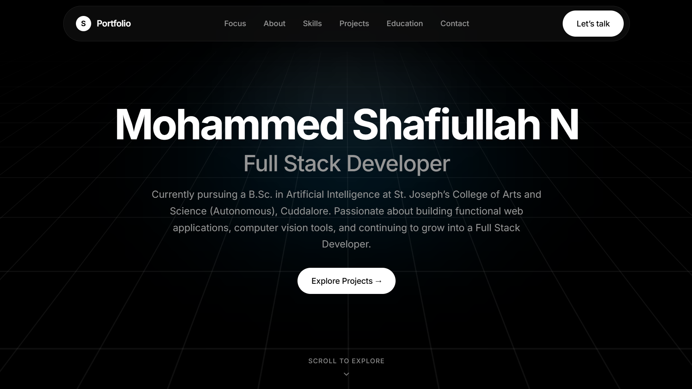

# Muhammad Shafiullah N — Developer Portfolio

**A personal portfolio showcasing my skills, projects, and journey in software development.**

[**View Live Portfolio →**](https://shafiullah-portfolio-teal.vercel.app/) · [GitHub](https://github.com/Shafyydev) · [LinkedIn](https://www.linkedin.com/in/shafyy/)

---

## Overview

I am a B.Sc. Artificial Intelligence student at St. Joseph's College of Arts and Science (Autonomous), Cuddalore, working toward becoming a Full Stack Developer.

This portfolio presents my technical skills, educational background, projects, and professional interests in one place. It reflects my ongoing journey in web development and my interest in building practical applications and computer vision tools.

## Portfolio Preview

**[Explore the Live Website →](https://shafiullah-portfolio-teal.vercel.app/)**

## Features

- **Personal Introduction** — An overview of my background and career direction.
- **About Me** — Information about my interests and development journey.
- **Focus Areas** — Highlights the areas of technology I am interested in.
- **Technical Skills** — Presents my development skills and tools.
- **Projects** — Showcases selected projects and practical work.
- **Education** — Details my academic background.
- **Contact Section** — Provides ways to connect with me professionally.
- **Responsive Interface** — Designed to present portfolio content across screen sizes.
- **Dark Visual Design** — A minimal, dark-themed interface with custom styling.

## Technology Stack

| Technology | Purpose |
|---|---|
| React | Building reusable user interface components |
| Vite | Frontend development and production build tooling |
| JavaScript | Application logic and interactivity |
| CSS3 | Layout, styling, and visual presentation |
| ESLint | Code-quality checks |
| Git and GitHub | Version control and source code hosting |

## Featured Projects

Explore the Projects section of my portfolio to discover my work.

You can also browse my repositories on GitHub:

**[View My GitHub Projects →](https://github.com/Shafyydev?tab=repositories)**

## About Me

I am focused on strengthening my programming fundamentals, improving my web development skills, and building practical projects as I progress toward becoming a Full Stack Developer.

I believe in learning through implementation, improving through consistent practice, and developing projects that demonstrate practical technical ability.

## Connect With Me

- **Portfolio:** [shafiullah-portfolio-teal.vercel.app](https://shafiullah-portfolio-teal.vercel.app/)
- **GitHub:** [@Shafyydev](https://github.com/Shafyydev)
- **LinkedIn:** [Muhammad Shafiullah](https://www.linkedin.com/in/shafyy/)
- **Email:** [shafyy.officials25@gmail.com](mailto:shafyy.officials25@gmail.com)

---

  Designed and developed by Muhammad Shafiyullah.

