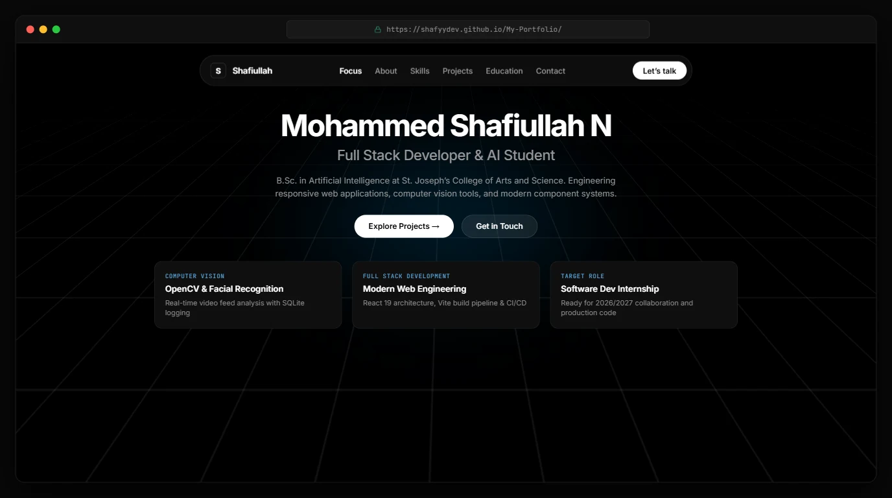

# Muhammad Shafiullah — Developer Portfolio

**A personal portfolio showcasing my skills, projects, and journey in software development.**

[**Live Portfolio**](https://shafiullah-portfolio-teal.vercel.app/) | [GitHub](https://github.com/Shafyydev) | [LinkedIn](https://www.linkedin.com/in/shafyy/)

---

## Overview

This is my personal developer portfolio, created to present my background, technical skills, projects, and professional interests in one place.

I am a B.Sc. Artificial Intelligence student working toward becoming a full-stack developer. This portfolio highlights my learning journey and practical work, providing recruiters, developers, and potential collaborators with a straightforward way to explore my profile and contact me.

## Portfolio Preview

**[Explore the Live Website](https://shafiullah-portfolio-teal.vercel.app/)**

## Features

- **Personal Introduction** — An introduction to my background and development goals.
- **About Me** — An overview of my interests and direction in software development.
- **Education** — Information about my academic background.
- **Technical Skills** — A presentation of the technologies and tools I work with.
- **Project Showcase** — Selected projects demonstrating practical applications of my skills.
- **Contact Links** — Direct ways to connect with me professionally.
- **Component-Based Interface** — A React application organized into dedicated interface components.
- **Custom Styling** — A consistent visual design implemented with CSS.

## Technology Stack

| Technology | Purpose |
|---|---|
| React | Building reusable user interface components |
| Vite | Frontend development and production build tooling |
| JavaScript | Application logic and interactivity |
| CSS3 | Layout and visual styling |
| ESLint | Code quality and lint checks |
| Git and GitHub | Version control and source code hosting |
| GitHub Actions | Automated deployment workflow |

## Deployment

- **Live Portfolio:** [Visit My Website](https://shafiullah-portfolio-teal.vercel.app/)
- **GitHub Repository:** [Shafyydev/My-Portfolio](https://github.com/Shafyydev/My-Portfolio)
- **GitHub Pages:** [View GitHub Pages Deployment](https://shafyydev.github.io/My-Portfolio/)

## About Me

I am a B.Sc. Artificial Intelligence student interested in software engineering and web development.

My current goal is to strengthen my programming fundamentals, build practical projects, and progress toward full-stack development.

I use personal projects to apply what I learn, improve my problem-solving skills, and demonstrate my development progress.

## Connect With Me

- **GitHub:** [@Shafyydev](https://github.com/Shafyydev)
- **LinkedIn:** [Muhammad Shafiyullah](https://www.linkedin.com/in/shafyy/)
- **Portfolio:** [Visit My Website](https://shafiullah-portfolio-teal.vercel.app/)
- **Email:** [shafyy.officials25@gmail.com](mailto:shafyy.officials25@gmail.com)

---

**Designed and developed by Muhammad Shafiyullah.**
